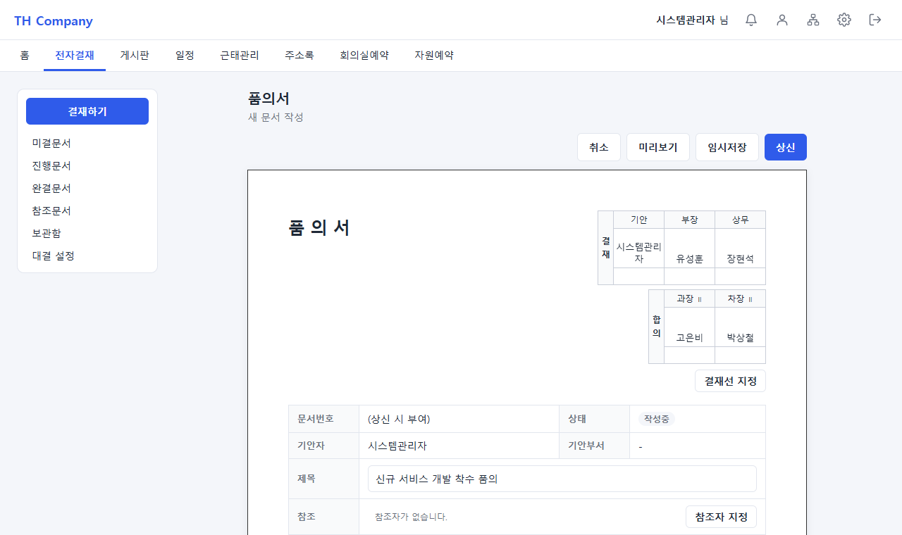
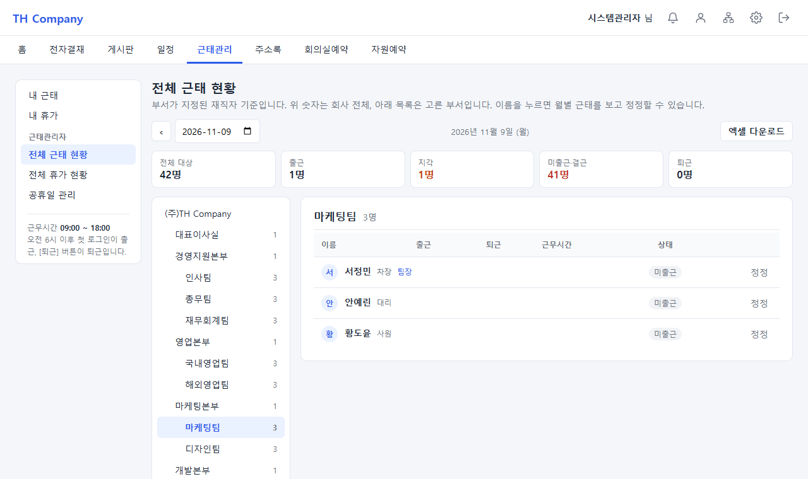
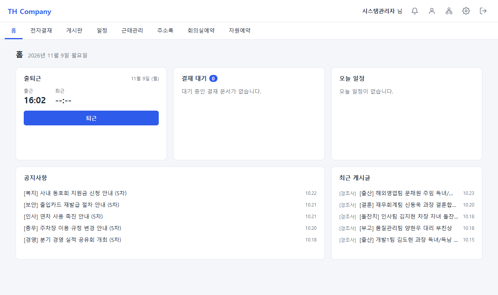
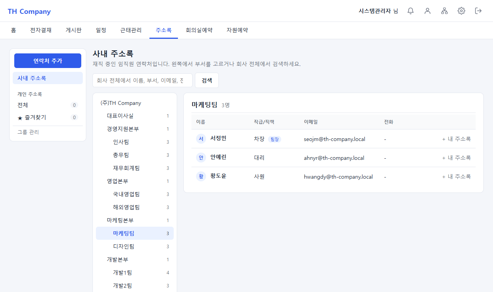

# TH Company 그룹웨어

중소기업 한 곳이 사내에서 쓰는 그룹웨어를 Spring Boot 로 만든 개인 프로젝트입니다.
전자결재, 근태·휴가, 게시판, 일정, 주소록, 조직도, 회의실·자원 예약, 실시간 알림과 관리자 화면까지
업무 흐름이 실제로 돌아가도록 구현하고, 기능마다 통합 테스트를 붙였습니다.

| 전자결재 작성 (결재란 + 병렬 합의란) | 전체 근태 현황 (조직도 형식) |
|---|---|
|  |  |
| **홈** | **사내 주소록** |
|  |  |

> 화면의 인물과 부서는 모두 개발용 가상 데이터입니다.

## 기술 스택

| 구분 | 사용 기술 |
|---|---|
| 언어 / 빌드 | Java 17, Gradle |
| 백엔드 | Spring Boot 4.1, Spring MVC, Spring Security 7, Spring Data JPA (Hibernate 7) |
| 화면 | Thymeleaf, 직접 작성한 CSS / JavaScript (프런트엔드 프레임워크 없음) |
| DB | MariaDB (테스트는 H2 인메모리) |
| 문서 출력 | openhtmltopdf (PDF), 직접 구현한 xlsx 작성기 (엑셀) |
| 실시간 | Server-Sent Events (`SseEmitter`) |

## 주요 기능

**전자결재**
- 양식(품의서, 휴가신청서 등) 기반 작성, 임시저장, 미리보기, 상신, 회수, 재기안
- 결재선 지정 창에서 사람마다 **결재 / 합의(순차) / 합의(병렬)** 선택, 끌어서 순서 변경
- 승인, 반려, 전결, 대결(부재 시 대신 결재할 사람 지정), 참조자
- 미결·진행·완결·참조 문서함, 일괄 승인
- 결재란과 합의란이 있는 A4 문서 화면, 인쇄, **PDF 저장**

**근태 · 휴가**
- 오전 6시 이후 첫 로그인으로 출근, [퇴근] 버튼으로 퇴근 (야근 후 새벽 퇴근은 전날 근무로 기록)
- 지각·미출근 표시, 근태관리자의 출퇴근 정정
- 연차(입사일 기준 자동 계산, 개별 조정), 휴가 신청은 전자결재와 연동
- 전체 근태 현황, 전체 휴가 현황 **엑셀 다운로드**
- 공휴일 관리

**협업**
- 게시판(관리자가 구성, 공지 게시판 글은 홈 공지사항에 노출), 댓글, 첨부파일, 상단 고정
- 개인·회사 일정 캘린더
- 회의실, 비품·장비·차량 예약 (시간 겹침 방지)
- 사내 주소록, 개인 주소록(그룹, 즐겨찾기), 조직도
- **실시간 알림**: 결재 차례, 결재 결과 등이 생기면 상단 종 숫자가 바로 바뀌고 화면 아래에 알림이 뜬다

**관리자**
- 사용자, 부서, 직급·직책 코드 관리
- 세부 권한 부여 (게시판, 근태, 일정, 결재양식, 회의실, 자원 관리자)
- 게시판 구성, 결재 양식, 예약 자원 관리
- 사용자 메뉴와 관리자 메뉴의 순서 변경

## 설계에서 신경 쓴 점

**사람 목록은 모두 조직도 형식**
사용자 관리, 전체 근태·휴가 현황, 사내 주소록은 왼쪽 부서 트리에서 부서를 고르면 오른쪽에 그 부서 인원이 나옵니다.
화면마다 따로 만들지 않고, 부서 트리와 선택 규칙(요청한 부서 → 내 부서 → 인원이 있는 첫 부서)을
`OrgChartService.deptView` 와 `DeptView` 로 한 번만 구현해 같이 씁니다. 검색은 부서와 상관없이 회사 전체에서 찾습니다.

**합의를 결재선의 "단계"로 표현**
결재선 한 줄마다 종류(결재/합의)와 단계(stage)를 둡니다. 이어진 병렬 합의자는 같은 단계로 묶어 동시에 차례가 되고,
그 단계의 모두가 처리해야 다음 단계가 열립니다. 순차 합의와 결재는 한 단계에 한 명입니다.
그래서 순차·병렬·혼합 결재선을 같은 승인 로직(`ApprovalService.approve`) 하나로 처리합니다.
합의자는 전결할 수 없고, 마지막 결재자는 반드시 결재여야 한다는 규칙을 상신할 때 검사합니다.
기존 문서는 새 컬럼이 비어 있어도 "결재, 단계 = 순번"으로 읽히도록 해서 데이터 변환 없이 이어집니다.

**알림은 트랜잭션이 커밋된 뒤에만 보낸다**
알림은 각 기능의 트랜잭션 안에서 저장되므로, 결재 처리가 실패해 롤백되면 알림도 남지 않습니다.
실시간 전송은 `@TransactionalEventListener(AFTER_COMMIT)` 에서 하므로, 롤백된 작업의 알림이 화면에 먼저 뜨는 일이 없습니다.
사용자별로 여러 탭의 연결을 들고 있고, 끊긴 연결은 정리하며, 다시 연결하면 그 시점의 안 읽은 수를 먼저 보냅니다.

**문서 출력은 서버에서**
PDF 는 화면 캡처가 아니라 서버에서 PDF 전용 템플릿(`approval/pdf.html`)을 그려 openhtmltopdf 로 만듭니다.
문서를 볼 권한이 있는 사람만 받을 수 있고, 한글은 함께 넣은 나눔고딕에서 쓰인 글자만 담습니다.
엑셀은 xlsx 가 XML 을 zip 으로 묶은 형식이라는 점을 이용해 작은 작성기(`XlsxWriter`)를 직접 만들었습니다 (머리글 고정, 숫자·글자 셀).

**권한**
역할은 관리자(ADMIN)와 일반(USER) 둘이고, 업무별 관리 권한은 사람에게 따로 부여합니다.
URL 단위 접근 제어는 `SecurityConfig` 에, 문서 열람처럼 데이터에 따라 달라지는 권한은 서비스에서 검사합니다.

## 실행 방법

**준비물**: JDK 17, MariaDB

1. DB 와 계정을 만듭니다. `db/init.sql` 을 참고하되, 비밀번호는 직접 정합니다.
2. 프로젝트 루트에서 설정 파일을 복사하고 DB 비밀번호를 적습니다. 이 파일은 git 에 올라가지 않습니다.
   ```bash
   cp application-local.properties.example application-local.properties
   ```
3. 실행합니다. 테이블은 처음 실행할 때 자동으로 만들어집니다.
   ```bash
   ./gradlew bootRun
   ```
4. http://localhost:8080 에 접속합니다.

- 처음 실행하면 관리자 계정 `sysadmin` 이 만들어집니다. 초기 비밀번호는 `AdminAccountInitializer` 에 있으니, 로그인한 뒤 마이페이지에서 바로 바꾸세요.
- 접속 정보는 환경변수 `DB_URL`, `DB_USERNAME`, `DB_PASSWORD`, `PORT`, `UPLOAD_DIR` 로도 바꿀 수 있습니다.
- 개발용 가상 임직원 목록과 샘플 예약 데이터는 [`db/sample-data.md`](db/sample-data.md) 에 정리해 두었습니다.
  임직원은 관리자 화면에서 등록하고, 게시글과 예약은 아래처럼 한 번 실행해서 채웁니다 (`posts` 대신 `reservations`).
  ```bash
  ./gradlew bootRun --args="--app.sample-data=posts --app.sample-data.exit=true --server.port=0"
  ```

## 테스트

```bash
./gradlew test
```

H2 인메모리 DB 위에서 Spring 컨텍스트 전체를 띄우는 통합 테스트 117개가 있습니다.
MockMvc 로 로그인부터 화면 요청까지 실제 흐름대로 확인하고, 시각이 중요한 근태 테스트는 시계를 바꿔 끼워 검증합니다.
예: 병렬 합의가 모두 끝나야 다음 결재로 넘어가는지, 권한 없는 사람이 문서 PDF 를 받을 수 없는지,
내려받은 엑셀이 올바른 xlsx 인지, 알림이 커밋 뒤에 받는 사람의 연결로만 가는지.

## 프로젝트 구조

```
src/main/java/th_prj/th_company/
├── approval/      전자결재 (문서, 결재선, 합의, 대결, 양식, PDF)
├── attendance/    출퇴근, 근태 현황, 정정
├── leave/         연차, 휴가 신청
├── holiday/       공휴일
├── board/         게시판, 댓글
├── schedule/      일정
├── reservation/   회의실·자원 예약
├── address/       사내·개인 주소록
├── org/           부서, 조직도 공통 화면 모델
├── member/        사용자, 권한, 직급·직책
├── notification/  알림 저장과 실시간 전송
├── menu/ admin/   메뉴 순서, 관리자 화면
├── file/          첨부파일
├── common/        공통 예외, 엑셀 작성기
├── config/        보안 설정
├── dev/           개발용 샘플 데이터 생성 (옵션을 줄 때만 동작)
└── web/           사용자 화면 컨트롤러
src/main/resources/
├── templates/     Thymeleaf 화면
├── static/        CSS, JavaScript
└── fonts/         PDF 용 나눔고딕
```

## 라이선스 · 출처

- PDF 출력에 쓰는 나눔고딕은 NHN Corporation 의 글꼴로, SIL Open Font License 1.1 에 따라 함께 배포합니다
  ([`src/main/resources/fonts/NanumGothic-OFL.txt`](src/main/resources/fonts/NanumGothic-OFL.txt)).
